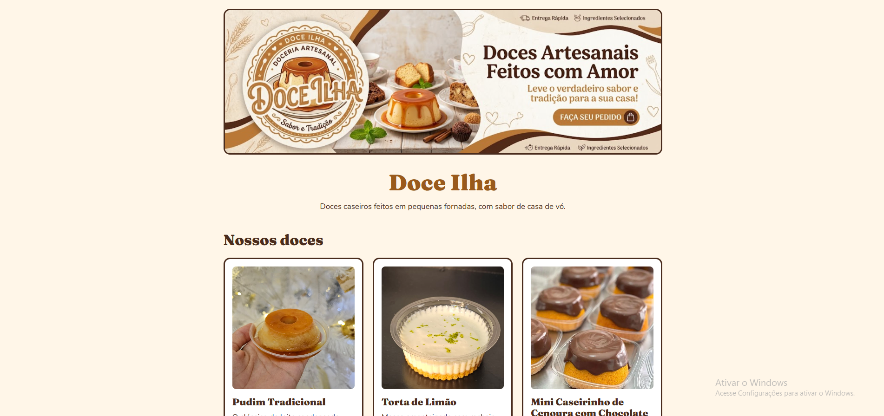
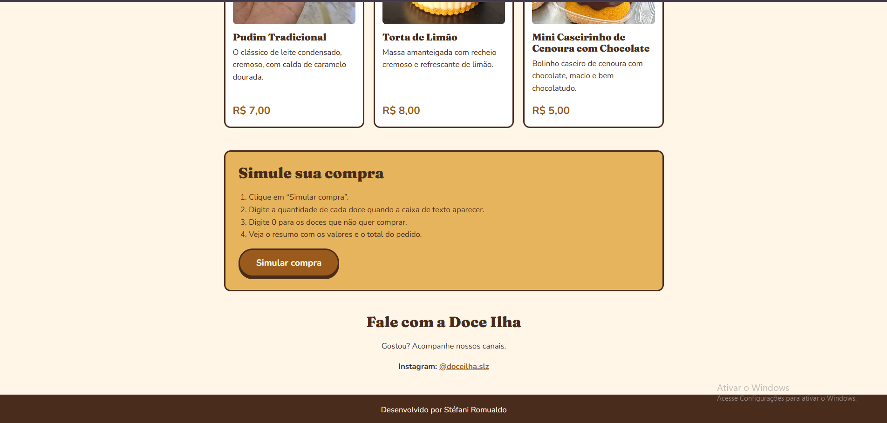

# Loja Virtual de Doces — Doce Ilha

Loja Virtual de Doces — Doce Ilha
Projeto: Desafio 1 — Minha Loja: Simulador de Compras
Aluna: Stefani Romualdo Costa
Trilha: Desenvolvimento Mobile

## Apresentação da loja

A Doce Ilha é uma loja virtual de doces caseiros e artesanais. A página apresenta o cardápio com três produtos e permite simular uma compra: a pessoa informa a quantidade de cada doce e recebe o valor de cada item e o total do pedido.

### Produtos e preços

Produto 1: Pudim Tradicional
Descrição: O clássico de leite condensado, cremoso, com calda de caramelo dourada
Preço: R$ 7,00

Produto 2: Torta de Limão
Descrição: Massa amanteigada com recheio cremoso e refrescante de limão
Preço: R$ 8,00

Produto 3: Mini Caseirinho de Cenoura com Chocolate (bolo de cenoura)
Descrição: Bolinho caseiro de cenoura com chocolate, macio e bem chocolatudo
Preço: R$ 5,00

## Tecnologias

- **HTML5**: estrutura da página.
- **CSS3**: layout, cores e identidade visual da loja.
- **JavaScript**: simulação da compra com `prompt()`, `Number()`, `alert()` e o atributo `onclick`.
- **VS Code**: editor usado para escrever o código.
- **Node.js**: instalado no computador como apoio durante o desenvolvimento. Não é necessário para executar o projeto.

## Como executar

1. Baixe ou clone este repositório.
2. Abra a pasta do projeto no VS Code (opcional).
3. Abra o arquivo `index.html` em um navegador (dois cliques no arquivo ou botão direito > Abrir com).
4. Clique em **Simular compra** e responda às caixas de texto com a quantidade de cada doce. Digite `0` para não comprar um produto.
5. Ao final, o resumo da compra aparece em uma janela de alerta.

Não é preciso instalar nenhuma dependência.

## Estrutura do projeto

assets/
  banner.png
  captura.png
  caseirinho.jpg
  pudim.jpg
  assets/sitefinal.png
  assets/siteinicio.png
  torta.jpg
index.html
README.md
style.css
script.js

## Captura de tela

## Testes realizados

Os testes foram feitos no navegador, clicando em **Simular compra** e digitando as quantidades na ordem: Pudim, Torta, Caseirinho.

| # | Entrada | Resultado esperado | Resultado |
|---|---|---|---|
| 1 | 0, 0, 0 | "Nenhum produto foi selecionado." | OK |
| 2 | 1, 0, 0 | Total R$ 7,00 | OK |
| 3 | 1, 1, 1 | Total R$ 20,00 | OK |
| 4 | 2, 1, 2 | Total R$ 32,00 | OK |
| 5 | 3, 2, 4 | Total R$ 57,00 | OK |
| 6 | "abc" em qualquer produto | Alerta de quantidade inválida | OK |
| 7 | -1 em qualquer produto | Alerta de quantidade inválida | OK |
| 8 | 1.5 em qualquer produto | Alerta de quantidade inválida | OK |
| 9 | Clicar em "Cancelar" em todas as perguntas | "Nenhum produto foi selecionado." | OK |

## Dificuldade encontrada e o que aprendi

Minha maior dificuldade foi descobrir a causa dos erros no código. Em um deles, o banner não aparecia na página, e o Console do navegador (tecla F12) mostrava que o arquivo não era encontrado.

Para resolver, fui testando uma possibilidade de cada vez: lia a mensagem de erro, conferia o código, corrigia, salvava, atualizava a página e testava de novo. O problema era o caminho da imagem, que precisava ser `assets/banner.png`, com o arquivo dentro da pasta `assets`.

Com isso aprendi a ler as mensagens de erro, a usar o Console do navegador, a importância de conferir caminhos e nomes de arquivos e a testar uma mudança de cada vez para descobrir a causa de um problema.

## Uso de IA

Usei a IA 

Utilizei a inteligência artificial do Gemini como apoio durante o desenvolvimento.

Recorri à IA para ajudar a entender e solucionar alguns erros específicos no código (por exemplo, quando ocorria um erro em determinada linha e eu não conseguia identificar o motivo, pedia auxílio para pensar nas possibilidades, testava as soluções e compreendia a lógica).

Também utilizei a IA como suporte para gerar ideias e referências para as imagens e arte visual da loja.

Para complementar o aprendizado, consultei tutoriais e vídeos no YouTube para esclarecer dúvidas e entender melhor os conteúdos que não estavam claros.

Realizei a validação abrindo a página no navegador, executando os testes manuais da tabela acima, utilizando o Console (F12) para depuração de erros e conferindo todos os cálculos passo a passo.